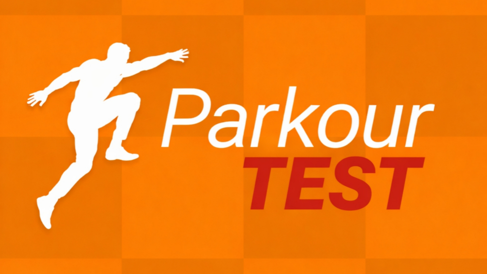
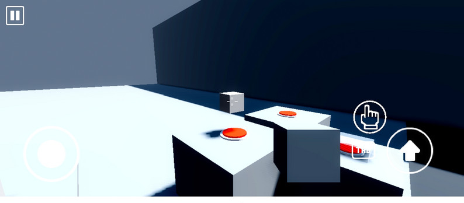
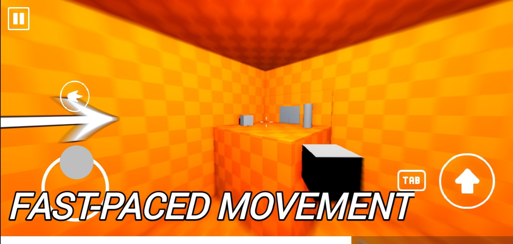
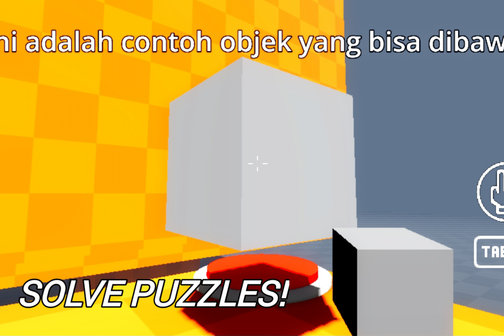
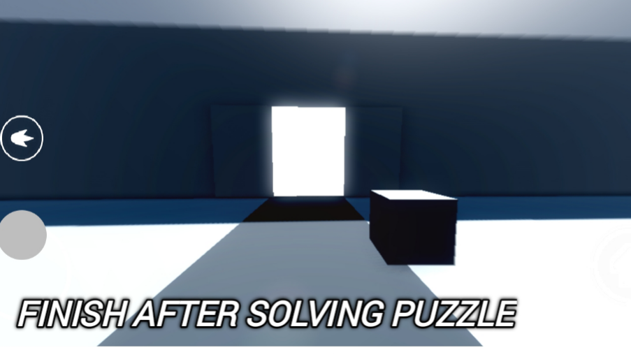

# 

**An Experimental Puzzle-Parkour Experience**  
*Explore. Solve. Overcome.*

[Play on itch.io](https://hikkiv.itch.io/parkourtest) · [View Repository](https://github.com/Handukkan/Parkour-Test)

---

## Table of Contents

- [Overview](#overview)
- [Gameplay](#gameplay)
- [Features](#features)
- [Screenshots](#screenshots)
- [Gameplay Footage](#gameplay-footage)
- [Technical Information](#technical-information)
- [System Requirements](#system-requirements)
- [Installation](#installation)
- [Development History](#development-history)
- [Development Status](#development-status)
- [Credits](#credits)

---

## Overview

**Parkour Test** is an experimental puzzle-platforming game that combines parkour mechanics, environmental exploration, and interactive puzzles into a single experience.

Players must navigate through various environments, overcome obstacles, interact with physical objects, and solve environmental puzzles to unlock the exit door. Each level introduces different challenges that encourage exploration, experimentation, and problem-solving.

Originally developed as an experimental project, Parkour Test continues to evolve through gameplay improvements, new content, and mechanical refinements.

---

## Gameplay

The core gameplay revolves around three fundamental elements:

| Element | Description |
| :--- | :--- |
| **Exploration** | Discover environments, navigate through levels, and find interactive elements. |
| **Parkour** | Traverse obstacles and overcome environmental challenges. |
| **Puzzle Solving** | Interact with objects and mechanisms to unlock the exit and progress. |

Progression is level-based. Players must complete the available puzzles before they can proceed through the exit door.

---

## Features

- **Puzzle-Based Gameplay** – Solve environmental puzzles to unlock new paths and complete levels.
- **Parkour Mechanics** – Navigate through obstacles and challenging environments.
- **Explorable Levels** – Discover different environments and challenges across eight playable levels.
- **Physics-Based Interactions** – Interact with physical objects and use them as part of the puzzle-solving experience.
- **Gamepad Support** – Compatible with external game controllers.
- **Low-End Device Compatibility** – Designed to run on relatively modest Android hardware.

---

## Screenshots

A look into the world of Parkour Test.

<!-- Replace the placeholders with actual repository image paths. -->

| Gameplay | Core Mechanics |
| :---: | :---: |
|  |  |

| Puzzle Interaction | Level Finish Line |
| :---: | :---: |
|  |  |

---

## Technical Information

| Property | Details |
| :--- | :--- |
| **Project Name** | Parkour Test |
| **Game Engine** | Godot Engine |
| **Genre** | Puzzle / Platformer / Parkour |
| **Primary Platform** | Android |
| **Latest Version** | 0.07 |
| **Current Level Count** | 8 |
| **Architecture Support** | ARMv7 and above |
| **Graphics API** | OpenGL |

---

## System Requirements

The following specifications represent the stated minimum hardware requirements.

| Component | Minimum Requirement |
| :--- | :--- |
| **Chipset** | MediaTek Helio G35 |
| **GPU** | PowerVR GE8320 |
| **RAM** | 3 GB |
| **Storage** | At least 200 MB free |
| **Graphics API** | OpenGL |
| **Processor Architecture** | ARMv7 or higher |
| **x86 Architecture** | Not supported |

**Additional Information:**
- Supports Android devices with compatible 32-bit and 64-bit architectures.
- 64-bit support was introduced for Android 16 devices and above.
- Actual performance may vary depending on the device and its hardware configuration.

---

## Installation

### Downloading the Game
The latest playable release is distributed through itch.io.

1. Visit the official [Parkour Test game page](https://hikkiv.itch.io/parkourtest).
2. Download the available Android build (`ParkourTest3264Release.apk`).
3. Install the APK on a compatible Android device.
4. Launch the game.

### Accessing the Project
This repository contains the development project rather than just the compiled game. To work with the project:

1. Clone or download this repository.
2. Open **Godot Engine**.
3. Import the project using its `project.godot` file.
4. Allow Godot to import the necessary project resources.
5. Open the project and explore its contents.

---

## Development History

Parkour Test has undergone multiple development iterations, introducing new levels, gameplay mechanics, and improvements.

### Version 0.07 *(Latest Release)*
- Added Level 8.
- Fixed the floor bug in Level 7.
- Changed the game introduction.
- Introduced 64-bit support for Android 16 devices and above.
- General bug fixes and gameplay improvements.
- *Note: The game size increased to over 100 MB due to additional 64-bit support (81 MB APK on itch.io).*

### Version 0.06
- Added Level 7 *(actively improved)*.
- Enhanced sound effects.
- Revised Level 5.
- General bug fixes and gameplay improvements.

### Version 0.05 Alpha
- Added Level 6.
- Introduced the Drop Item Mechanism.
- General bug fixes and gameplay improvements.

---

## Development Status

**Current Version:** `0.07`

Parkour Test currently features eight playable levels. Development remains ongoing, with additional levels and gameplay improvements planned for future releases. Existing mechanics and environments may receive further adjustments as development progresses.

---

## Credits

| Role | Contributor |
| :--- | :--- |
| **Developer** | HikkiV |
| **Development Studio** | Handukkan Game Studios |
| **Game Engine** | Godot Engine |

---

**PARKOUR TEST**  
*Explore. Solve. Overcome.*

An independent game development project by **Handukkan Game Studios**.

[itch.io](https://hikkiv.itch.io/parkourtest) · [GitHub Repository](https://github.com/Handukkan/Parkour-Test)

